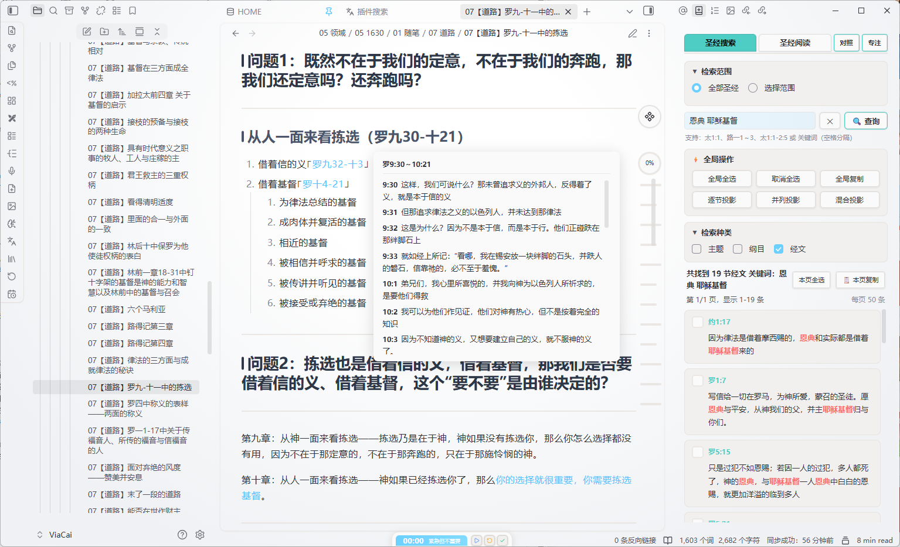
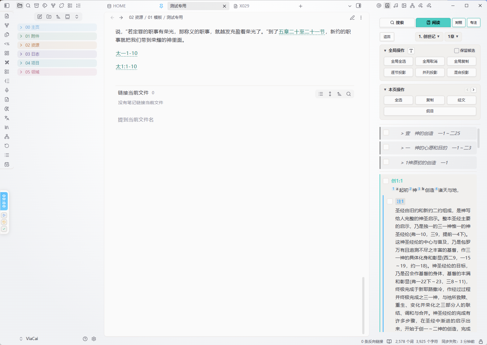
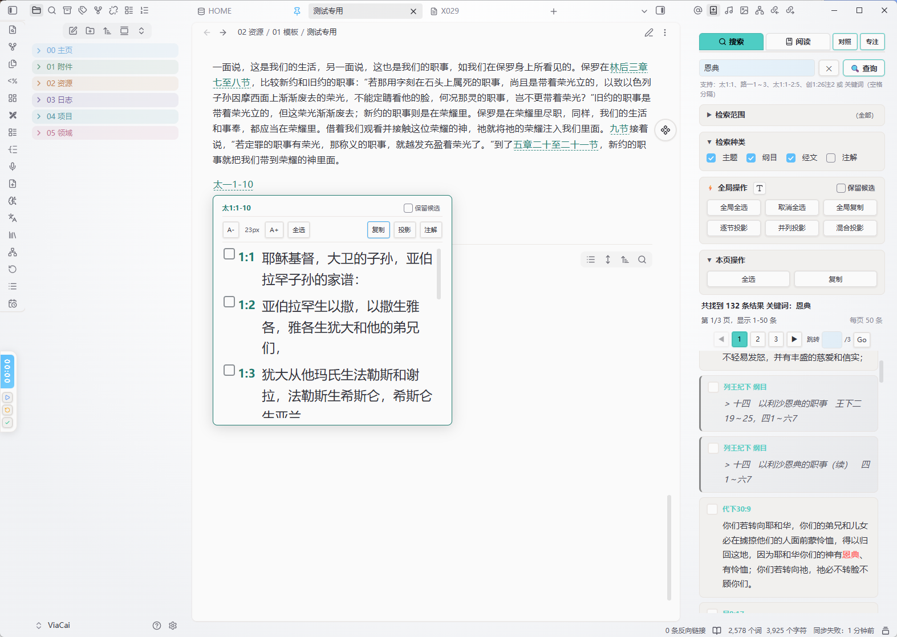
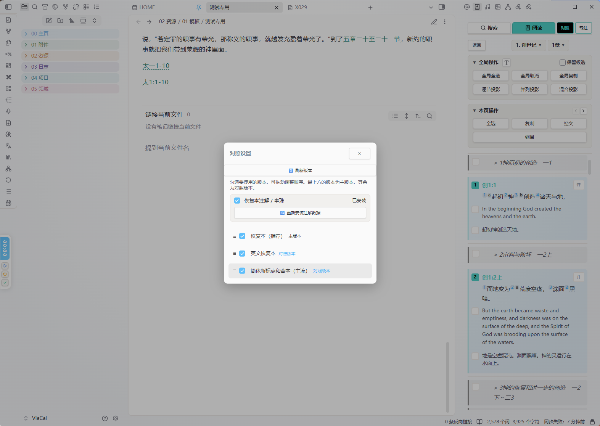
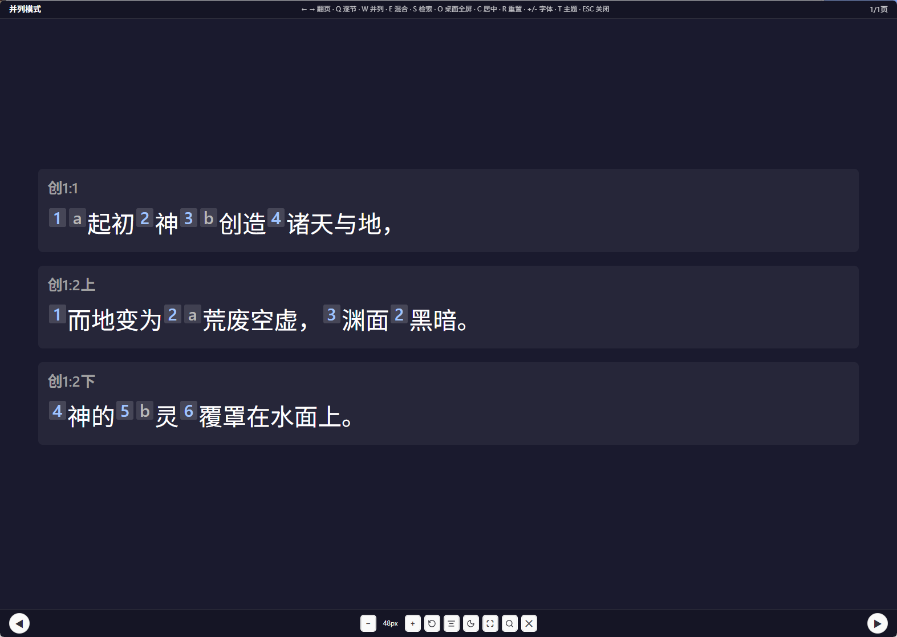

# 圣经检索与阅读 (Bible Search and Reader) 

 

> Obsidian 插件，用于多版本圣经数据的检索、阅读与投影。支持内置恢复本和和合本对照、智能检索语法和投影模式。



> 📖 使用教程（含演示视频）：[公众号教程](https://mp.weixin.qq.com/s/Ylzdu8Lr9hNePXNilQs4NQ)

## ✨ 核心亮点

> 📖 在 Obsidian 里一站式**检索、阅读、投影**中文圣经——内置恢复本注解 / 串珠、懂中文的检索语法、多版本对照，适合个人读经，也适合小组查经与主日学。

### 1. 恢复本注解与串珠，内嵌在经文里
阅读恢复本时，注脚与串珠以 ¹ ᵃ 上标直接标在字里行间，点一下就在该节下方展开注文或串珠经文，可选中、复制、投影。不用跳出 Obsidian，也不用手动翻书。



### 2. 懂中文的检索语法
支持经文出处（`太1:1`、`路一1～3`）、按注 / 串出处（`1:26注2`）、关键词组合与混合检索；读笔记时还能自动识别文中的圣经引用并一键跳转。



### 3. 多版本对照，并排读经
阅读、检索或点开经文弹窗时都可开启对照，一节经文下方并排显示多个中文版本，方便比对用词与语气；每个版本都有自己的候选框，所选内容可一键复制或投影。



### 4. 投影模式，小组查经利器
选中经文后能逐节、并列或混合全屏投影，投影内可直接检索新内容并即时更新；支持键盘 / 滚轮 / 触屏操作，适合主日学、小组查经现场使用。



## 快速开始

### 首次安装引导

1. **安装插件**：从 Obsidian 社区插件市场搜索 "Bible Search and Reader" 安装启用
2. **版本选择引导**：启用后自动弹出引导窗口，显示已安装的版本和可下载的版本
3. **选择版本**：勾选需要的圣经版本（可多选），点击「下一步」
4. **自动下载**：若选择的版本本地不存在，插件自动从 GitHub 下载对应数据文件
5. **开箱即用**：下载完成后直接点击左侧 📖 图标开始使用

> 📦 所有圣经数据以内置 JSON 形式存放在插件目录（vault 内 `.obsidian/plugins/bible-search-reader/`），仓库不会增加额外文件。

### 数据缺失自动检测

插件每次启动时都会真实扫描插件目录下的圣经数据文件。如果数据文件被删除或从未下载，会自动弹出版本选择引导窗口，确保始终至少有一个可用的圣经版本。

### 跨书卷选中管理

阅读视图中，选中内容仅在当前书卷内有效。切换书卷时会自动过滤掉旧书卷的选中项，避免计数跨书卷累加。同一书卷内跨章节选中不受影响，方便投影连续章节内容。

### 版本管理

在插件设置中可管理已安装的版本：
- **启用/禁用**：控制哪些版本可用
- **设置主版本**：选择检索和阅读时的默认版本
- **删除版本**：移除不再需要的版本数据
- **下载新版本**：从列表中选择并下载新的圣经版本

## 功能详解

> 下方按模块列出完整功能；新手上手建议先看上方「核心亮点」与「快速开始」。

- **多版本圣经支持**：同时加载多个圣经版本，支持恢复本、新标点和合本及自定义版本
- **多版本对照阅读**：检索和阅读时可选开启对照模式，在主版本经文下方显示其他版本
- **版本选择引导**：首次安装或数据缺失时自动弹出引导窗口，帮助用户选择并下载所需的圣经版本
- **版本管理设置**：全新的版本管理界面，支持启用/禁用版本、设置主版本、删除版本、下载新版本
- **圣经搜索**：支持主题、纲目、经文、注解四种检索类型；可按全部圣经或自定义书卷范围搜索
- **智能检索语法**：支持经文出处（`太1:1`、`路一1～3`）、按注/串出处（`1:26注2`、`创1:26串1`）、关键词（多词组合匹配）、以及混合检索
- **阅读模式**：书卷/章节网格浏览，点击顶部书卷名 / 章数快速跳转，字体调节，主题与纲目同屏显示
- **恢复本注解与串珠**：恢复本（CRV）配套的注解与串珠数据，经文中以 ¹ ᵃ 上标内嵌，点击即在该节下方展开注文或串珠经文；注解/串珠可点击选中、复制、投影；支持「恢复本注解 / 串珠」开关，在阅读笔记、圣经检索 / 阅读页、经文弹窗等场景下按 **A** 一键开关（在输入框或笔记正文中打字时不会误触），数据首次用到时按需下载
- **投影模式**：选中内容后可逐节、并列或混合投影，支持键盘/滚轮/触屏操作；投影内可直接打开检索窗口检索新内容并更新投影；投影正文的注解（蓝）/串珠（琥珀）按段落分段渲染，可点选复制
- **保留候选**：勾选「保留候选」后，选中的经文会实时进入候选池并即时更新数量，可跨检索/跨书卷/跨标签页保留已选经文（经文弹窗中勾选的经文也可入池），按顺序累计投影；取消勾选后，经文弹窗 / 圣经搜索 / 圣经阅读各自保留自己的候选，各窗口分别投影
- **文章内圣经引用自动识别**：阅读笔记时，自动识别文中所出现的圣经引用，点击可查看经文内容，双击可查看经文上下文
- **自动更新**：支持启动时自动检测新版本，一键下载并安装更新

---

---

## 圣经版本

| 文件 | 说明 |
|------|------|
| `main.js` | 插件主程序（必要） |
| `manifest.json` | 插件清单（必要） |
| `styles.css` | 插件样式（必要） |
| `bible-crv-data.json` | 内置恢复本（CRV）经文数据（约 12MB） |
| `bible-crv-notes.json` | 恢复本注解 / 串珠数据，首次用到时按需下载 |
| `bible-cuvs-data.json` | 内置新标点和合本（CUVS）经文数据（约 13MB） |

> 💡 英文恢复本（ERV，`bible-erv-data.json`）为可下载数据，不随 Release 默认提供，可在设置 → 圣经版本管理中下载，与恢复本（CRV）对照显示。

> 💡 如需使用其他圣经版本，直接叫AI照着bible-crv-data.json的内容格式为模板，生成你所要的圣经版本，并照着下方的推荐命名表命名文件，比如思高本，就命名为bible-sgb-data.json


### 标准版本映射表

插件支持以下 14 个标准中文圣经版本：

| 版本名称 | 标准缩写 | 文件名 | 说明 |
|---------|---------|--------|------|
| 1919原版官话和合本 | CUV | `bible-cuv-data.json` | 原始和合本 |
| 简体新标点和合本 | CUVS / CUNP | `bible-cuvs-data.json` | 主流简体中文版本 |
| 和合本修订版 | RCUV | `bible-rcuv-data.json` | 和合本修订版 |
| 恢复本 | CRV / RCV | `bible-crv-data.json` |  Recovery Version，推荐 |
| 新译本 简体 | CNVS / CNV / NCV | `bible-cnvs-data.json` | 台湾圣经公会新译本 |
| 新译本 繁体 | CNVT | `bible-cnvt-data.json` | 繁体字版本 |
| 现代中文译本 | TCV | `bible-tcv-data.json` | 现代中文译本 |
| 当代圣经 简体 | CCB | `bible-ccb-data.json` | 当代圣经简体中文版 |
| 当代圣经 繁体 | CCBT | `bible-ccbt-data.json` | 当代圣经繁体中文版 |
| 新普及译本 | CNLT | `bible-cnlt-data.json` | 新普及译本 |
| 吕振中译本 | LZZ / LZC | `bible-lzz-data.json` | 吕振中译本 |
| 思高本 | SGB / SBV | `bible-sgb-data.json` | 思高圣经译本 |
| 牧灵圣经 | CCBIB | `bible-ccbib-data.json` | 牧灵圣经 |
| 中文标准译本 | CSBS / CSB | `bible-csbs-data.json` | 中文标准译本 |

> 💡 **默认提供版本**：恢复本 (CRV) 和新标点和合本 (CUVS) 在 Release 中默认提供。

### 自定义版本命名规则

使用其他中文圣经版本时，请按以下规则准备数据文件：

1. **文件命名**：`bible-{缩写}-data.json`
   - 示例：`bible-cuvs-data.json`、`bible-crv-data.json`
   - 缩写建议：使用 3-6 个字母的小写英文缩写
2. **数据格式**：JSON 数组，每条记录包含以下字段：
   ```json
   {
     "bookId": 1,
     "chapter": 1,
     "verse": 1,
     "type": "verse",
     "content": "起初神创造天地。",
     "testament": "OT",
     "bookShortName": "创",
     "bookFullName": "创世记",
     "lineIndex": 0
   }
   ```
3. **放置位置**：将文件放到插件目录（`.obsidian/plugins/bible-search-reader/`）下
4. **自动识别**：插件启动时会自动识别该版本，在设置中可启用并设为主版本

### 数据文件命名规范

| 文件类型 | 命名格式 | 示例 |
|---------|---------|------|
| 标准版本数据 | `bible-{缩写}-data.json` | `bible-cuvs-data.json` |
| 自定义版本数据 | `bible-{自定义缩写}-data.json` | `bible-myversion-data.json` |
| 版本元数据 | `versions.json` | （插件自动生成） |

---

## 使用指南

### 搜索

1. 点击左侧边栏 📖 图标或运行命令「打开圣经检索」
2. 点击「对照」按钮，在侧边栏勾选要使用的圣经版本（可多选）
3. 勾选多个版本时，最上方的版本为主版本，其余为对照版本，可拖动调整顺序
4. 选择检索种类（主题/纲目/经文）和范围，输入内容后点击「🔍 查询」
5. 开启多版本对照后，搜索结果下方会显示其他版本的对照经文
6. 点击结果卡片选中（可排序、标记并列），对照版本也有独立的候选框可选中
7. 点击「逐节/并列/混合投影」进行投影

### 阅读

1. 切换到「圣经阅读」选项卡
2. 点击书卷简称 → 章节编号 → 阅读内容；当前书卷在下拉里有高亮标记，点开书卷 / 章数下拉会自动把选中项滚到面板中部
3. 「本页操作」标题右侧有两个极小的上一章 / 下一章符号按钮，点击直接切章并回到章首；首章 / 末章自动置灰
4. 开启多版本对照后，每节经文下方会显示其他版本对照
5. 恢复本（CRV）经文中带 ¹ ᵃ 上标，点击即在该节下方展开注解或串珠（注解/串珠可点击选中、复制、投影）；把主版本切到恢复本会**自动开启**注解，在阅读 / 检索等场景下按 **A** 即可一键开 / 关（在输入框或笔记正文中打字时不会误触；该快捷键由插件直接处理，故不出现在「设置 → 快捷键」里，但命令面板仍可搜索并触发）
6. 「全局操作」标题右侧的字体按钮可调节阅读字号；点击卡片或对照版本的候选框选中内容，可进行复制或投影

### 翻页与键盘导航

**触屏**：检索结果区**左滑 = 下一页、右滑 = 上一页**；经文阅读页**左滑 = 下一章、右滑 = 上一章**，与页码按钮、「本页操作」里的上一章 / 下一章按钮完全一致，翻页后自动回到页首 / 章首。

- **跨书卷连续翻章**：阅读页到本卷末章继续往后会自动进入下一卷第一章（创 50 → 出 1），往前同理（出 1 → 创 50）；手势、按钮、键盘、鼠标与触控板共用这套逻辑，按钮提示会显示目标书卷名。创 1 往前、启 22 往后不越界。
- **移动端侧边栏避让**：从屏幕边缘起手仍交给系统返回 / 侧边抽屉；从内容区起手的横向手势只翻页，不会把侧边栏划走或划出。设置 →「移动端右滑翻上一页」默认开启，关闭后右滑完整交还给侧边栏（左滑仍可翻下一页）。

**桌面端**：

- **鼠标四向拖拽**：在内容区**任意位置（包括经文正文文字、对照经文、注文）**按住左键，像触屏一样四向滑动——**左 / 右拖**超过 60px 翻到下一页 / 上一页（阅读页为下一章 / 上一章，可跨书卷），**上 / 下拖**内容跟着手势实时滚动，不必再去找卡片空白处起手。拖拽期间会临时禁掉文字框选并显示抓取光标，松手即恢复，拖拽产生的那次点击也不会误选中卡片；链接、按钮、输入框、可编辑区仍照常点击。**需要选字复制时按住 `Shift` / `Alt`（或 `Ctrl` / `Cmd`）再拖即可**，原生选字完整保留；纯点击、短距离轻扫、上下拖都不会误翻页。
- **触控板横滑**：双指横向滑动累计到阈值即翻页；纵向滚轮照常上下滚动，横向滚轮不会触发浏览器前进 / 后退。

**键盘**（先点一下插件面板）：

| 按键 | 作用 |
| --- | --- |
| `←` / `→` | 上一页 / 下一页；阅读页为上一章 / 下一章（可跨书卷） |
| `↑` / `↓` | 唤出选框，逐条上下移动；目标超出屏幕时自动滚动到可见位置 |
| `空格` | 选中 / 取消当前条（未显示选框时选中当前显示的内容，未滚动过则第一条） |
| `B` | 切换当前条的「并」（并列显示）；未选中时先选中 |
| `C` | 清空所有选中（含候选池） |
| `X` | **本页全选 / 取消本页选中**：本页未全选时补齐为全选，已全选时取消本页全部选中（不影响其它页、其它标签页与候选池里的已冻结内容） |
| `I` | 打开 / 取消当前标签页的专注模式（与「专注 / 取消」按钮一致） |
| `Y` | 在「圣经搜索」与「经文阅读」之间来回切换 |
| `U` | 打开 / 关闭对照设置面板 |

**对照设置面板也能用键盘**：按 `U` 打开后，`↑ / ↓ / ← / →` 在弹窗内各选项之间移动选框——标题栏的「检查更新」「关闭」、刷新版本按钮、「恢复本注解 / 串珠」开关、注解数据按钮，以及每一个版本行；`空格` / `回车` 等于点下当前高亮项（勾选或取消版本、切换开关、按下按钮），首次按空格只唤出选框、不会误触第一项；`Esc` 或再按 `U` 关闭。勾选版本会让列表重绘，选框仍按版本身份停在同一项。弹窗打开期间，翻页手势、`X / I / Y` 与内容区的选框滚动跟随全部让行，关闭后恢复：**用 `U` / `Esc` / 关闭按钮 / 点遮罩任意一种方式关闭，焦点都会自动交还插件面板**，所以紧接着按 `I` 切专注、`Y` 切标签、`X` 全选或方向键都立刻生效，不用再点一下面板；笔记正文或输入框正在编辑时则不会抢焦点。

**书卷列表与章目录也能用方向键**：这两个页面与内容页共用同一套选框——`← / →` 在书卷 / 章号之间逐个移动，`↑ / ↓` 按网格的视觉行上下移动并保持所在列，`空格` / `回车` 等于点下当前高亮的按钮（选书卷 → 进章目录 → 打开该章），`Esc` / `Backspace` 从章目录退回书卷列表。这两个页面里 `← / →` 不翻页，`B` / `C` 也不生效，避免误改已选内容；鼠标 / 触屏点选与滚动跟随规则与内容页一致。

**选框也会跟着鼠标 / 手指走**：用鼠标或触屏点选任意内容条（含候选框、「并」标签、对照行），`↑ / ↓` 的选框立即移到那一条，接着按方向键或空格就从新位置继续；选中后整页重绘，选框仍按内容身份停在同一条，不会因列表顺序变化而漂走。触屏滑动、鼠标拖拽、触控板横滑或键盘 `← / →` 翻到新页 / 新章后，选框会移到新内容里的新目标（优先该页已选中的条目，否则第一条），目标超出屏幕时自动滚动到可见。输入框、工具栏按钮、经文弹窗 / 投影打开时不移动选框；关闭「键盘导航」后一并停用。

**选框也会跟着滚动走**：上下滚动搜索结果或经文阅读后，选框会落到当前显示在屏幕上的内容——滚出视野时移到视口里最靠上的内容条（顶部那条被裁掉大半就取下面第一条完整露出的），往回滚同样跟回来；选框本身还在视野内时不跳，轻微滚动不会让框乱跑。如果选框还没唤出，滚动会先记住当前位置，之后按 `↑ / ↓` 或 `空格` 就从这里开始，不会跳回第一条。翻页复位滚动、`↑ / ↓` 把目标滚进视野这类程序自动滚动不会把框反向拽走；切换标签页、翻页 / 换章、关闭视图时都会清理跟随状态。

焦点在输入框、笔记正文或经文弹窗 / 投影打开时全部让行（焦点停在工具栏按钮上时 `X / I / Y / U` 仍可用）；输入法合成态、带修饰键的按键不拦截，插件原有的全局 A / Q / W / E 快捷键不受影响——它们与面板内的裸字母键互不冲突。`X` 全选逐条沿用手动点选的序号与「保留候选」规则，整页只重绘一次；书卷列表与章目录没有「选中」概念，`X` 在那里不生效。

以上四组能力可在 **设置 → 检索与阅读** 分别开关（默认全部开启）：「左右滑动翻页」「移动端右滑翻上一页」「鼠标拖拽与触控板横滑翻页」「键盘导航」。上下滚动、点击、长按选字、多指缩放、可横向滚动的容器、书卷列表与章目录列表都不会误触翻页手势。

**移动端按钮**：顶部「对照」「专注」始终显示为实心高对比色块——在搜索框打字、展开检索范围、阅读经文或内容重绘时也不会变透明或被遮挡；「对照」激活时只换底色与内描边，文字固定为「对照」不变，进入专注模式后按钮显示「取消」。「全局操作」标题右侧的字体按钮、以及「本页操作」里的上一章 / 下一章按钮统一为 28px 触控目标，带边框与底色，两种主题下都能看清、点得中；搜索页「全局操作」标题左侧统一为折叠箭头，不再出现闪电符号。

### 对照设置说明

- **全局对照面板**：点击「对照」按钮打开，同时影响圣经检索和圣经阅读视图
- **版本排序**：拖动调整版本顺序，最上方为显示优先级最高的主版本
- **独立操作**：对照版本的经文拥有独立的候选框，可独立选中用于复制和投影
- **简洁显示**：对照经文不再显示版本全名，直接显示经文内容，复制/投影时自动补上版本简称和出处
- **投影支持**：逐节、并列、混合投影均支持同时显示多个版本，对照版本自动弱化显示

### 全局操作与本页操作

**全局操作**（作用于整个书卷或所有已选中内容）：
- **保留候选**（标题右侧复选框）：两个标签页与经文弹窗共用同一个开关。勾选后，选中的经文会**实时**进入候选池——每选中一处就立即按序加入，右侧的候选数量与经文序号即时刷新，重新搜索、切换书卷/章节、切换标签页、开关弹窗都不会丢失（主版本与对照版本均保留）；取消勾选某处经文也会立即从候选池移除。经文弹窗的「保留候选」开关默认不勾选，勾选后弹窗内勾选的经文同样进入候选池。刚勾选开关时已有的选中项会立即纳入候选池。默认关闭时保持原有行为（切换书卷会清空旧书卷选中项）。点击「清空」可一键清空保留的候选（「取消全选」也会一并清空）。取消勾选时会把已保留的候选按来源归还到检索页 / 阅读页，两个视图都从 1 重新开始编号
- **全局全选**：按顺序选中当前书卷所有章节的主版本内容（含主题）
- **全局取消**：取消所有已选中的内容（跨所有章节）
- **全局复制**：复制所有已选中的内容
- **逐节/并列/混合投影**：投影所有已选中的内容

**本页操作**（仅作用于当前章节，与「全局操作」一样为可折叠区块）：
- **全选**：选中当前章的主版本内容（第一章额外包含主题）
- **复制**：仅复制当前章已选中的内容
- **经文**：复制当前章主版本的全部经文
- **纲目**：复制当前章主版本的纲目

### 投影操作

左上角点一下「逐节模式 ▾」可展开模式菜单，直接切换逐节 / 并列 / 混合，或跳到 Hymns 的诗歌全屏 / 窗口投影（没装 Hymns 时诗歌项会置灰说明）。插件启用后侧边栏会自动出现检索面板，可在设置里关掉。

- `←/→` 或 `空格`：翻页
- `+/-`：调整字体大小
- `Q` / `W` / `E`：投影已打开时在逐节 / 并列 / 混合三种模式间即时切换并重绘（无需翻页）；在投影标签里再按同键即关闭，从别的标签按则先切回投影标签
- `D`：经文投影全屏 / 退出全屏（移动端不支持）
- `O` / `P`：交给 Hymns 插件，分别是诗歌全屏投影 / 诗歌窗口投影（同键可关闭）
- 从诗歌投影按 `Q` / `W` / `E` 切回经文时，原本是全屏就仍是全屏、原本是窗口就仍是窗口，来回切换不会串状态
- `T`：在暗色（深底白字）/ 亮色（浅底深字）/ 蓝黄（蓝底黄字）/ 黄黑（黄底黑字）四套主题间依次循环；默认主题可在「设置 → 经文投影默认主题」里改，按 `T` 只切当前投影、不改默认值
- 搜索框输入单独一个书卷简拼（如 `csj`）＝显示整卷创世记；并列模式下整卷按「一章一页」分页，**书卷主题放在第一章那一页的开头**，不单独占一页。简拼撞车时（如 `th` 对应帖撒罗尼迦后书 / 提摩太后书）在下拉里选定后会补成可唯一定位的完整短拼（`tslnjhs` / `tmths`）
- 查不到结果时（无论此前是否已经投影过别的内容）都会清空旧内容，整屏显示「没有找到匹配的内容」与具体查询词；显式确认时按 `Z` 可退回上一版投影内容
- **长按顶部搜索框**（约 0.5 秒）弹出书卷 / 章数选择器：书卷区左侧旧约、右侧新约，章数区按所选书卷列出全部章；两区各有独立滚动条，互不影响。点章数即把该章投影出来，点「整卷」则投影整卷（并列模式一章一页）；`ESC` 或点选区外关闭，默认停在当前查询所在的书卷 / 章
- 底部工具栏（符号 / 图标按钮，窄窗口下中间按钮自动换行，左右翻页始终固定在两端）：
  - `−` / `+`：缩小 / 放大字体，中间显示当前字号
  - 旋转箭头：重置字体大小
  - 对齐图标：切换居中（开启时高亮为蓝色）
  - 主题图标（月亮 / 太阳 / 调色板 / 对比度）：与 `T` 同效，依次切换四套主题
  - 放大镜图标（检索）：在不关闭投影的情况下，把投影区宽度收窄、右侧空出侧边栏显示圣经检索；检索并选中新经文后点击「逐节/并列/混合投影」，投影内容会**原地更新**（尺寸不变），拖动侧边栏宽度时投影区自动跟随
  - 全屏图标（同一按钮切换）：把投影恢复为满屏
  - `✕`：关闭投影
- `ESC`：退出投影（菜单开着先收菜单；全屏投影先退回窗口，再按一次才关闭）

### 自动识别文章中的圣经引用

- **单击经文出处**：单击打开经文弹窗，显示具体经文内容
- **双击经文出处**：双击跳转到圣经阅读区域中查看该经文的上下文

**📚（进阶）省略书卷名的写法（上下文继承）**：

- 只写章节、没写书卷时，会自动沿用**本文档前文中最后出现的书卷**；跨行、跨段落都有效（换一篇笔记会重新开始）。例如：

```
壹　神的创造　创一1～二25
一　神的心愿和目的　一1～二3      ← 创世记 1:1～2:3
1神原初的创造　一1，路一1-二2     ← 创世记 1:1；路加福音 1:1～2:2
2 神看一切都甚好　4              ← 路加福音 2:4（续接前一处范围的结束章）
如在四章一节的内。约翰一章一节说到的话。  ← 路加福音 4:1；约翰福音 1:1
二章一节                        ← 约翰福音 2:1
```

- 章上下文取前一处的**结束章**：`路一1-二2` 之后单写 `4` 即为路加福音 2:4
- 同一行内的省略写法不会被后面才出现的书卷名带偏：`一1，路一1-二2` 中的 `一1` 仍按创世记解析
- 成串的省略写法会一次高亮：`一2，一3，二4` 识别为一处引用（创世记 1:2、1:3、2:4）

**经文弹窗操作**：

- `A-` / `A+`：缩小 / 放大弹窗字体（调整后的字体大小会被记住，下次弹窗自动沿用）
- `注解 / 串珠` 开关（工具条）：打开 / 关闭恢复本注解与串珠的显示，与阅读页、检索页、投影同步
- `全选` / `取消`：合并为同一个按钮——未全选时显示「全选」，已全选时自动变成「取消」
- `复制`：复制弹窗中已勾选的经文（带出处）。勾选「保留候选」且候选池或圣经搜索 / 圣经阅读中也有选中经文时，会先弹出「本页复制 / 全局复制」供选择；否则只复制本弹窗的经文
- `投影`：点击后给出「逐节 / 并列 / 混合」三种投影模式。未勾选「保留候选」时只投影本弹窗的经文；勾选后按全局顺序投影候选池与各页面的选中经文
- `保留候选`（标题行，默认不勾选）：勾选后，弹窗中勾选的经文会实时进入候选池，可与圣经搜索 / 圣经阅读的选中项一起投影；取消勾选某节会即时移出候选池。右侧的候选数量与圣经搜索 / 圣经阅读保持一致——勾选时显示候选池总数，未勾选时只统计本弹窗自己的候选
- 标题行在候选数量大于 0 时显示 `清空`，与圣经搜索 / 圣经阅读的「清空」一致：**一次清空三个窗口的全部候选**（经文弹窗 / 圣经搜索 / 圣经阅读，含所有经文弹窗的候选）
- 未勾选「保留候选」时，每处经文引用的弹窗都**独立统计**、从 1 开始编号，弹窗之间互不累计；关闭再打开仍然保留
- 每处经文前是与圣经搜索 / 圣经阅读相同的**候选框**：未选中是空框，选中后在框内直接显示**选中顺序**编号——未勾选「保留候选」时按本弹窗从 1 开始编号，勾选后按全局顺序编号，与实际投影顺序一致
- 选中后的经文后面会出现**「并」标签**（与圣经搜索 / 圣经阅读一致）：点击切换为「✓ 并列」，混合投影时该节会与前一节合并到同一页
- **点击弹窗中的经文出处**（顶部出处或每节前的 `章:节`）：跳转到圣经阅读页面对应的经文位置，方便查看上下文；**点击经文内容**才是选中 / 取消这一节，与经文搜索的操作一致
- **多版本对照**：开启对照后，每节主版本下方会列出其它已启用且已安装的版本（不再标注版本名，配色与阅读页一致），可单独勾选、复制或投影；对照数据缺失时只显示主版本，不影响正常使用
- 三个窗口（经文弹窗 / 圣经搜索 / 圣经阅读）各自保留自己的候选：取消勾选「保留候选」时，各窗口的选中项仍然保留，在哪个窗口点「投影」就只投影哪个窗口的内容

---

## 检索语法速查（进阶参考）

### 经文出处

| 输入 | 含义 |
|------|------|
| `加1:1` | 加拉太书1章1节 |
| `路一1～3` | 路加福音1章1至3节 |
| `太1:1-2:5` | 马太福音1章1节至2章5节 |
| `太1:1, 5` | 马太福音1章1节和1章5节（同书卷延续引用） |
| `约一1, 十四7~21, 23` | 约翰福音1:1、14:7-21、14:23（混合延续） |

### 关键词匹配

分隔符决定匹配行为：

| 分隔符 | 模式 | 顺序敏感 | 结果排序 |
|--------|------|----------|----------|
| 空格 / 顿号 `、` | 同时包含（AND） | 否 | 经文顺序 |
| 逗号 `，` `,` | 同时包含（AND） | **是**（按输入顺序） | 经文顺序 |
| 分号 `；` `;` | 包含任意（OR） | 是 | 关键词顺序 |
| 句号 `。` `.` | 包含任意（OR） | 否 | 经文顺序 |

### 按注 / 串出处

在经文出处后加 `注N` / `串N` 可直接检索对应的注解或串珠条目（命中即返回该条注解或串珠的出处与正文）：

| 输入 | 含义 |
|------|------|
| `1:26注2` | 当前书卷第 1 章 26 节的第 2 条注解 |
| `创1:26串1` | 创世记 1:26 的第 1 条串珠 |
| `太5:3注1` | 马太福音 5:3 的第 1 条注解 |

---

## 更新

### 插件本体更新

插件支持自动检测更新：
- **自动检测**：设置 → 插件更新 → 自动检测更新（默认开启），启动时自动检查新版本
- **手动检查**：设置 → 插件更新 → 🔍 检查更新
- **一键更新**：检测到新版本后，点击「立即更新」即可自动下载并安装

**更新说明**：无论用哪种方式安装或更新（插件自带的更新功能、Obsidian 第三方插件市场、BRAT、手动覆盖安装），只要版本号发生变化，下次启动 Obsidian 时都会自动弹出**最新版的更新内容**（内置更新日志优先，缺失时自动从 GitHub 拉取）；版本没变就不会重复弹。想随时回看，可以运行命令「查看当前版本的更新说明」，或在设置 → 插件更新里点「📜 查看」。

### 圣经数据更新

> 插件本体的自动更新**只会下载** `main.js` / `manifest.json` / `styles.css`，
> 不会带上十几 MB 的圣经数据文件。所以圣经数据单独有一套更新机制。

圣经数据（恢复本、和合本）托管在仓库 main 分支的 `data/` 目录，并配有版本清单
`bible-data-manifest.json`（记录每个数据文件的版本号、大小、校验值与本次变更说明）。

- **自动检测**：开启「自动检测更新」后，启动时联网比对云端清单（12 小时节流一次）
- **发现更新**：右下角弹出常驻通知，显示哪些数据文件有修正版及大致体积，
  提供「查看详情 / 立即更新 / 稍后」
- **查看详情**：列出本次改了什么，例如修复了哪些经文缺失、对齐了哪些分节边界
- **一键更新**：确认后自动下载并覆盖，覆盖前把旧数据备份为 `<文件名>.old`，
  全部完成后自动重新加载圣经数据
- **手动检查**：运行命令「检查圣经数据更新」，或在设置 → 圣经版本管理里点「🔍 检查数据更新」

以后若再发现数据错误，只需更新 `data/` 下的文件并修改清单里的版本号与变更说明，
再推送到 GitHub，已安装的用户启动时就会收到提示并可一键完成更新。

---

## 兼容性说明

### 数据源模式

- **2.1.0 起仅支持内置数据模式**，移除了外置数据模式，简化架构
- 旧版本数据自动迁移：自动检测旧版 `bible-data.json` 并迁移为恢复本（CRV）版本

### 平台支持

- 移动端与桌面端均支持
- 数据文件统一通过 Obsidian 的 Vault Adapter API 读写（vault 内 `.obsidian/plugins/bible-search-reader/`），桌面端与移动端行为一致

---

## Highlights

- **Recovery Version notes & chains inline**: ¹ ᵃ superscripts in the text expand notes / chains in place — selectable, copyable, projectable, no need to leave Obsidian.
- **Chinese-aware search**: verse refs (`太1:1`), note/chain refs (`1:26注2`), keyword combos, and Bible references auto-detected inside your notes with one-click jump.
- **Side-by-side comparison**: open comparison in reading or search to show multiple Chinese versions under each verse; selected content can be copied or projected in one click.
- **Projection mode**: verse-by-verse / side-by-side / mixed fullscreen projection for group study; search new content right inside the projection and update the slide in place.

## Overview

Bible Search and Reader is an Obsidian plugin for searching, reading, and projecting multiple Chinese Bible versions in parallel. It features built-in multi-version data, smart search syntax, side-by-side comparison reading, fullscreen projection modes, inline Bible reference highlighting inside your notes, Recovery Version notes & chain superscripts, and a first-run setup wizard.

## Installation

**Method 1 — Obsidian Community Plugins (recommended):**

1. In Obsidian, open Settings → Community plugins → Browse
2. Search for "Bible Search and Reader" and click **Install**
3. Click **Enable** to activate the plugin

**Method 2 — From GitHub Releases (manual):**

1. Download `main.js`, `manifest.json`, and `styles.css` from the latest release
2. Create the folder `.obsidian/plugins/bible-search-reader/` in your vault
3. Copy the three files into that folder
4. Enable the plugin in Settings → Community plugins

**First-run setup:**

1. After enabling, a version selection wizard opens automatically
2. Tick the Bible version(s) you want (multiple allowed), then click "Next"
3. Missing data files are downloaded automatically from GitHub
4. Once done, open the plugin via the 📖 icon in the left ribbon

The plugin works on desktop and mobile. Data files are stored inside the vault at `.obsidian/plugins/bible-search-reader/`, so no external files are added to your vault.

**What's new after updating**: however the plugin was installed or updated (its built-in updater, Obsidian's community plugin store, BRAT, or copying files in manually), it compares the last recorded version with the current one on startup and shows the **latest release notes** whenever the version changes (built-in changelog first, fetched from GitHub when missing). It never re-shows the same version. You can also re-open it anytime with the "View release notes for the current version" command or the 📜 button under Settings → Plugin update.

## Usage

- **Search**: click the 📖 ribbon icon (or run the "Open Bible Search" command). Pick the search type (theme / outline / verse / note) and range, type a query, and search.
- **Search syntax**: verse references like `太1:1`, `路一1～3`, `加1:1-2:5`, note/chain references like `1:26注2` / `创1:26串1`, plus keyword matching. Space/`、` = AND, `，`/`,` = ordered AND, `；`/`;` = ordered OR, `。`/`.` = unordered OR.
- **Comparison reading**: click the "对照" button to enable side-by-side versions. The top version is the primary one; drag to reorder. Each version's verses have independent checkboxes for copying and projection.
- **Reader view**: switch to the "圣经阅读" tab, pick a book and chapter, then read. The current book is highlighted in the book dropdown, and two tiny prev/next-chapter buttons sit at the right of the "本页操作" header for quick chapter jumps (first/last chapter greyed out). Recovery Version verses carry ¹ ᵃ superscripts — click to expand the note or chain (selectable, copyable, projectable); switching the primary version to CRV auto-enables notes, and the **Ctrl/Cmd + Shift + A** shortcut toggles them. A font button next to "全局操作" resizes the reader. Selected verses can be copied or projected.
- **Projection**: select verses, then choose "逐节 / 并列 / 混合投影". Controls: `←/→`/`Space` to navigate, `+/-` for font size, `Q`/`W`/`E` to switch between verse-by-verse / side-by-side / mixed modes live (no page turn needed), `T` to toggle theme, `ESC` to exit. The bottom bar uses icon buttons (`−`/`+` font size, reset, center, moon/sun theme, search); the prev/next buttons stay pinned to both ends while the middle buttons wrap onto a second line in narrow windows. The search icon shrinks the projection horizontally and reveals the Bible search panel in the right sidebar; re-projecting updates the slide in place, and the maximize icon restores full screen. Notes (blue) and chains (amber) render as segmented paragraphs and are selectable for copy.
- **Projection search**: the search icon in the projection bottom bar opens the search window without closing the projection; re-select verses and project to update.
- **Keep candidates**: the 「保留候选」 checkbox beside "全局操作" is shared by both tabs. Once ticked, every verse you select is added to the candidate pool **in real time** — the counter and verse numbers update immediately, and nothing is lost on re-search, book/chapter switch or tab switch. Unticking a verse removes it from the pool at once. A 「清空」 button clears the pool. Unticking the checkbox releases kept candidates back to the search/reader view and restarts numbering from 1.
- **Reference highlighting**: while reading notes, Bible references in the text are automatically highlighted. References that omit the book name inherit the last book mentioned earlier in the same note (works across lines and paragraphs), and a bare verse number continues from the end chapter of the previous range. Single-click a reference to open the verse popup (font +/-, a combined 全选/取消 toggle, 复制 and 投影, per-verse checkboxes that show the selection-order number once selected (same box style as the search / reader tabs), a 「并」 tag behind each selected verse for side-by-side projection, and remembered font size). The popup keeps its own candidates: with 「保留候选」 unticked, the popup, the search tab and the reader tab each keep their own selections, and projecting from one of them only projects that window's content (each reference's popup numbers its own verses from 1, and the selections survive closing the popup). Its header shows 保留候选 + count + a 清空 button; the count follows the same rule as the search / reader tabs (shared pool total when ticked, the popup's own count when unticked), and 清空 clears every window's candidates at once (popup + search + reader). With 「保留候选」 ticked, popup verses join the shared pool so everything is projected together; 复制 then offers 本页复制 / 全局复制, and 投影 offers 逐节 / 并列 / 混合. Double-click a reference (or a `章:节` inside the popup) to jump to the reader view.
- **Page turning & keyboard navigation**: swipe left/right on touch screens for the next/previous page (search) or chapter (reader); chapter turning crosses book boundaries automatically (Genesis 50 → Exodus 1, and back). On mobile, horizontal gestures started inside the content no longer drag the sidebar away or pull out the left drawer, while edge swipes remain reserved for the system — toggle 「移动端右滑翻上一页」 if you prefer right-swipe for the sidebar. On desktop, hold the left mouse button anywhere in the content — including directly on verse text, comparison verses or note text — and drag in any direction like on a touch screen: dragging left/right past 60px turns the page/chapter, dragging up/down scrolls the content with your hand. Text selection is temporarily disabled during a drag (and the synthetic click after a drag is swallowed), while links, buttons, inputs and editable areas keep their normal behaviour; hold `Shift`/`Alt` (or `Ctrl`/`Cmd`) while dragging to keep native text selection and copying. Two-finger horizontal trackpad swipes also turn pages; vertical wheel scrolling is untouched. After clicking the panel, use `←/→` to turn pages/chapters, `↑/↓` to show a selection box and move it item by item (auto-scrolls when the item would leave the screen), `Space` to select/deselect the focused item, `B` to toggle its 「并」 (side-by-side) tag (selecting it first if needed), and `C` to clear every selection. The `↑/↓` selection box also follows mouse and touch: clicking or tapping any item (including its checkbox, 「并」 tag or comparison row) moves the box there, and it stays on the same item after a re-render even if the row order changes. After turning a page/chapter by touch, mouse drag, trackpad, arrow keys or buttons, the box moves to a target in the new content — the first already-selected item, or the first item otherwise — and scrolls into view when needed. The box also follows scrolling: when the search results or reader content is scrolled and the focused item leaves the viewport, it moves to the topmost visible item (or the next fully visible one if that item is mostly cut off) and follows back when scrolling up, while staying put for small scrolls that leave it visible. If the box has not been shown yet, scrolling just anchors it to the current position, so the first `↑/↓` or `Space` starts from what is on screen instead of the first item. Programmatic scrolling (page-turn resets, auto-scrolling a focused item into view) never pulls the box away. Keys are ignored while typing in an input, note editor, button, or while a verse popup / projection is open; existing `A`/`Q`/`W`/`E` shortcuts are unaffected. All four groups can be toggled under Settings → Search & reader (all on by default). The book-list and chapter-grid pages share the same selection box: `←/→` move one item, `↑/↓` move by visual grid row, `Space`/`Enter` activate the highlighted book or chapter and `Esc`/`Backspace` return to the book list; on those pages `←/→` do not turn pages and `B`/`C` are inactive. On mobile, 「对照」/「专注」 stay solid, high-contrast buttons in both light and dark themes even while typing in the search box, changing the search scope, reading a chapter or re-rendering content; activating 「对照」 only changes its background and inset outline (the label stays 「对照」), while focus mode shows 「取消」. The font / previous-chapter / next-chapter icon buttons are 28px tappable targets with explicit borders and colours, and the search page's 「全局操作」 header starts with the normal collapse arrow instead of a lightning bolt. Vertical scrolling, tapping, text selection, multi-touch, horizontally scrollable containers, popups and projections never trigger a page turn.
- **Action shortcuts & keyboard control of the comparison panel**: after clicking the plugin panel, `X` selects every item on the current page (or deselects them all when the page is already fully selected), `I` toggles focus mode, `Y` switches between the search and reader tabs, and `U` opens/closes the comparison settings. While that panel is open, `↑/↓/←/→` move a highlight across its options (header buttons, refresh button, notes toggle, notes-data button and each version row), `Space`/`Enter` activates the highlighted option (the first `Space` only reveals the highlight, so nothing is triggered accidentally), and `Esc` or `U` closes it. The highlight stays on the same version after the list re-renders. Whichever way you close the panel (`U`, `Esc`, the close button or the backdrop), focus is handed back to the plugin panel automatically, so `I`, `Y`, `X` and the arrow keys work immediately again without an extra click — focus inside the note editor or an input is never stolen. Input fields, IME composition and modifier-key combos are ignored, and turning off "Keyboard navigation" disables all of these together with the other panel shortcuts.
- **Version management**: in plugin settings, enable/disable versions, set the primary version, delete versions, or download new ones.

---

## 许可证

MIT License

## ☕ 如果觉得这款插件对您有帮助，也可以支持我的项目

加6:10 所以我们有了时机，就当向众人行善，尤其是向信仰之家的人。


